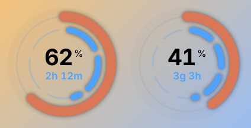
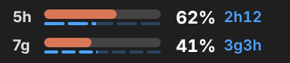
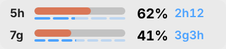
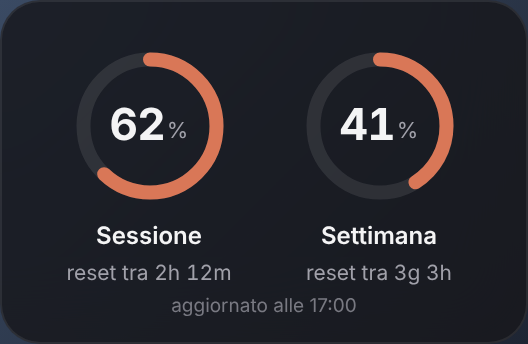
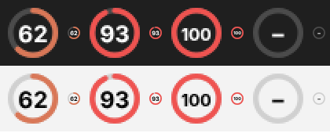

# Claude Usage Widget

Widget **non ufficiale** per Windows che mostra in sovraimpressione quanto hai consumato dei limiti del tuo abbonamento Claude: la **sessione** (finestra di 5 ore) e la **settimana**, con il tempo che manca a ogni reset.

> *English: an unofficial Windows overlay that shows your Claude plan usage (5‑hour session and weekly limits) with time to reset. Download the ZIP, run `INSTALLA.cmd`, done. UI and docs are in Italian.*

| Anelli | Barre (anche sopra la barra di Windows) | Riquadro |
|:---:|:---:|:---:|
|  | <br> |  |

Oppure come **icone vicino all'orologio**:



## Cosa fa

- Mostra le percentuali di consumo **di sessione e settimanali**, le stesse di *Impostazioni → Utilizzo* su claude.ai, con colori che passano ad ambra sopra il 75% e a rosso sopra il 90%.
- Mostra il **tempo al reset**, sia scritto ("2h 12m") sia come segmenti blu: 5 da un'ora per la sessione, 7 da un giorno per la settimana.
- **Quattro stili**: anelli, barre sottili da mettere sopra la barra di Windows, riquadro, icone vicino all'orologio.
- Si **aggiorna da solo ogni 15 minuti**, anche se usi Claude solo da browser o dall'app, e subito dopo ogni reset.
- **Parte da solo** all'accensione del PC.

## Requisiti

- Windows 10 o 11.
- Un abbonamento **Claude Pro o Max**: le percentuali esistono solo per questi piani.
- Node.js e Claude Code: se mancano **li installa l'installatore**.

## Installazione

1. In questa pagina clicca **Code → Download ZIP**.
2. Estrai lo zip (tasto destro → *Estrai tutto…*).
3. Fai doppio clic su **`INSTALLA.cmd`**.
   Se compare *"Windows ha protetto il PC"*: **Ulteriori informazioni → Esegui comunque**.
4. Segui la finestra. Fa tutto da sola:
   - installa Node.js e Claude Code se mancano
   - copia il widget in `%LOCALAPPDATA%\ClaudeUsageWidget`
   - ti fa accedere al tuo account Claude nel browser
   - attiva avvio automatico e aggiornamento ogni 15 minuti
   - avvia il widget

**Aggiornare:** scarica di nuovo lo ZIP e rilancia `INSTALLA.cmd`. Le tue impostazioni restano. Se trova una versione installata altrove, la sostituisce e ti chiede se cancellare la vecchia cartella.

**Disinstallare:** doppio clic su `DISINSTALLA.cmd`. Toglie widget, avvio automatico e aggiornamento; Node.js e Claude Code restano.

## Uso

| Azione | Cosa fa |
|---|---|
| Trascina con il tasto sinistro | Sposta il widget (lo stile *Barre* si può mettere sopra la barra di Windows) |
| Doppio clic | Cambia stile: anelli → barre → riquadro |
| Tasto destro → **Aggiorna ora** | Chiede subito il consumo attuale |
| Tasto destro → **Stile** | Anelli, Barre, Riquadro |
| Tasto destro → **Icone vicino all'orologio** | Nasconde il widget e mostra due icone; cliccandole torni sul desktop |
| Tasto destro → Opacità, Sempre in primo piano, Esci | — |

Passando il mouse su un anello, una barra o un'icona compare il dettaglio, per esempio *"Sessione: 62% usato · reset tra 2h 12m"*.

Su Windows 11 le icone nuove finiscono nel menu nascosto (freccia **^**): trascinale sulla barra per averle sempre visibili.

## Come funziona

```
Attività pianificata (ogni 15 min)  ─┐
"Aggiorna ora" / reset rilevato     ─┼─►  aggiorna.js  ─►  claude -p "ok" --model haiku --tools ""
                                     │                         │
                                     │                         ▼
                                     │        evento rate_limit_event (utilization, resetsAt)
                                     │                         │
                                     │                         ▼
                                     └──────────►  ~/.claude/usage-widget.json  ◄── widget (Electron)
```

- `aggiorna.js` fa una **richiesta minima** a Claude Code in modalità non interattiva (modello Haiku, nessuno strumento) e legge le percentuali dall'evento `rate_limit_event` che Claude Code emette a ogni risposta.
- Le percentuali sono quelle **dell'account**, quindi comprendono anche l'uso da claude.ai e dall'app.
- Il widget legge il file ogni 3 secondi. Se una finestra risulta scaduta, chiede subito il dato nuovo.
- Facoltativo: chi usa Claude Code può collegare anche la sua barra di stato con `node widget/setup.js`, così il widget si aggiorna dopo ogni risposta.

## Da sapere

- **Ogni aggiornamento è una vera richiesta a Claude**: piccola (Haiku, circa 14.000 token quasi tutti in cache), ma conta nei limiti del piano. Con un aggiornamento ogni 15 minuti sono circa 96 richieste al giorno con il PC acceso. Per cambiare intervallo: `node automazione.js installa 30` dalla cartella di installazione (da 10 a 240 minuti).
- Una richiesta **fa partire la finestra di 5 ore** anche quando non stai lavorando.
- Se nell'ambiente c'è una chiave API (`ANTHROPIC_API_KEY`), il widget la ignora per non fatturare a consumo.
- L'evento `rate_limit_event` **non è documentato ufficialmente**: se Anthropic lo cambia, gli anelli smettono di aggiornarsi. `node aggiorna.js --prova` dice cosa succede.
- Windows 11 non permette più di inserire contenuti dentro la barra delle applicazioni: lo stile *Barre* ci si appoggia sopra come finestra in primo piano, le *Icone* stanno nell'area di notifica.
- Nessun dato viene inviato altrove: l'unica connessione è la richiesta a Claude, con il tuo account.

## Struttura della repo

```
INSTALLA.cmd / installa.ps1        installatore (doppio clic)
DISINSTALLA.cmd / disinstalla.ps1  disinstallazione
widget/
  main.js, preload.js, renderer.js, index.html   il widget (Electron)
  aggiorna.js       lettura delle percentuali da Claude Code
  automazione.js    avvio automatico + attività pianificata di Windows
  migra.js          passaggio da una versione installata altrove
  setup.js, statusline-writer.js   integrazione facoltativa con la barra di stato di Claude Code
docs/                              screenshot
```

Per provarlo senza installare: `cd widget && npm install && npm run demo`.

## Licenza e avvertenze

Distribuito con licenza [MIT](LICENSE).

Progetto indipendente, **non affiliato né approvato da Anthropic**. "Claude" è un marchio di Anthropic, PBC.
