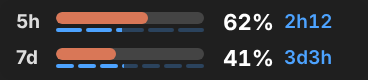
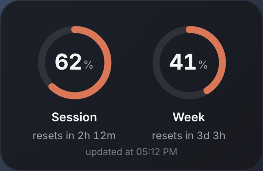

# Claude Usage Widget

An **unofficial** Windows overlay that shows how much of your Claude plan you have used: the **session** limit (5‑hour window) and the **weekly** limit, with the time left until each one resets.

| Rings | Bars (can sit on the taskbar) | Panel |
|:---:|:---:|:---:|
|  | <br> |  |

Or as **icons next to the clock**:


## Features

- **Session and weekly usage**: the same percentages you see in *Settings → Usage* on claude.ai. Colours switch to amber above 75% and to red above 90%.
- **Time to reset**, both as text ("2h 12m") and as blue segments: 5 one-hour segments for the session, 7 one-day segments for the week.
- **Four styles**: rings, thin bars you can place on top of the Windows taskbar, a panel, or icons next to the clock.
- **Refreshes by itself every 15 minutes**, even if you only use Claude in the browser or the desktop app, and right after every reset.
- **Starts automatically** when you sign in to Windows.

## Requirements

- Windows 10 or 11.
- A **Claude Pro or Max** plan: the usage percentages only exist for these plans.
- Node.js and Claude Code: **the installer installs them** if they are missing.

## Install

1. On this page click **Code → Download ZIP**.
2. Extract the zip (right-click → *Extract All…*).
3. Double-click **`INSTALL.cmd`**.
   If you see *"Windows protected your PC"*: **More info → Run anyway**.
4. Follow the window. It does everything on its own:
   - installs Node.js and Claude Code if they are missing
   - copies the widget to `%LOCALAPPDATA%\ClaudeUsageWidget`
   - opens your browser to sign in to your Claude account
   - turns on autostart and a refresh every 15 minutes
   - starts the widget

**Update:** download the ZIP again and run `INSTALL.cmd` again. Your settings are kept. If an earlier version is installed somewhere else, it is replaced, and you are asked whether to delete the old folder.

**Uninstall:** double-click `UNINSTALL.cmd`. It removes the widget, autostart and the periodic refresh; Node.js and Claude Code stay installed.

## Usage

| Action | What it does |
|---|---|
| Drag with the left button | Moves the widget (the *Bars* style can sit on top of the Windows taskbar) |
| Double-click | Switches style: rings → bars → panel |
| Right-click → **Refresh now** | Asks for your current usage right away |
| Right-click → **Style** | Rings, Bars, Panel |
| Right-click → **Icons next to the clock** | Hides the widget and shows two icons; click them to bring the widget back |
| Right-click → Opacity, Always on top, Quit | — |

Hover over a ring, a bar or an icon to see the details, e.g. *"Session: 62% used · resets in 2h 12m"*.

On Windows 11 new icons go into the hidden menu (the **^** arrow): drag them onto the taskbar to keep them visible.

## How it works

```
Scheduled task (every 15 min)  ─┐
"Refresh now" / reset detected ─┼─►  refresh.js  ─►  claude -p "ok" --model haiku --tools ""
                                │                        │
                                │                        ▼
                                │       rate_limit_event (utilization, resetsAt)
                                │                        │
                                │                        ▼
                                └──────►  ~/.claude/usage-widget.json  ◄── widget (Electron)
```

- `refresh.js` makes a **minimal request** to Claude Code in non-interactive mode (Haiku model, no tools) and reads the percentages from the `rate_limit_event` that Claude Code emits with every response.
- The percentages belong to your **account**, so they include usage from claude.ai and the apps too.
- The widget reads the file every 3 seconds. If a window has expired, it asks for fresh data right away.
- Optional: if you use Claude Code, you can also hook in its status line with `node statusline-setup.js` (from the install folder), so the widget refreshes after every Claude Code response.

## Good to know

- **Every refresh is a real request to Claude**: small (Haiku, about 14,000 tokens, mostly cached), but it counts towards your plan limits. With a refresh every 15 minutes that is about 96 requests a day while the PC is on. To change the interval, run `node automation.js install 30` from the install folder (10 to 240 minutes).
- A request **starts the 5‑hour window** even when you are not working.
- If an API key is set in your environment (`ANTHROPIC_API_KEY`), the widget ignores it so you are never billed per token.
- `rate_limit_event` is **not officially documented**: if Anthropic changes it, the widget stops updating. `node refresh.js --test` tells you what is happening.
- Windows 11 no longer lets apps put content inside the taskbar: the *Bars* style sits on top of it as an always-on-top window, and the *Icons* live in the notification area.
- No data is sent anywhere else: the only connection is the request to Claude, with your own account.

## Repository layout

```
INSTALL.cmd / install.ps1        installer (double-click)
UNINSTALL.cmd / uninstall.ps1    uninstaller
widget/
  main.js, preload.js, renderer.js, index.html   the widget (Electron)
  refresh.js          reads the usage from Claude Code
  automation.js       Windows autostart + scheduled task
  migrate.js          moves an earlier install from another folder
  statusline-setup.js, statusline-writer.js   optional Claude Code status line hook
docs/                            screenshots
```

To try it without installing: `cd widget && npm install && npm run demo`.

## License and disclaimer

Released under the [MIT license](LICENSE).

Independent project, **not affiliated with or endorsed by Anthropic**. "Claude" is a trademark of Anthropic, PBC.
